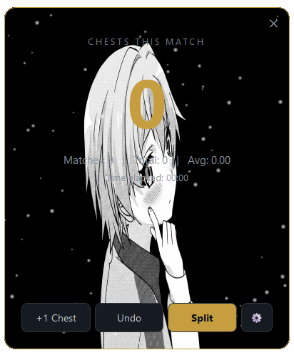
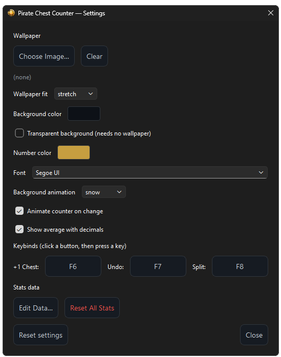

# Simple Fortnight Chest Counter (4 the pirate token!)

I made this because I needed a quick way to keep track of how many chests I was opening mid-match without alt-tabbing to a notepad or running some bloated overlay that eats half my RAM. Or some kind of injected dll that could get me banned or something... Vibecoded most of the hard parts, then went down a rabbit hole optimizing the rendering so it doesnt consume my resources.

It actually does sits cleanly on top of your game, listens to global hotkeys while you play, and lets you customize pretty much everything about how it looks.
I enjoy customization so I let almost everything be changed here.




## Features

- **Global Hotkeys:** Count chests without leaving your game (defaults to `F6` for +1, `F7` for Undo, `F8` for Split. all rebindable in settings).
- **Fully Customizable UI:**
  - Set any custom wallpaper (`cover`, `stretch`, or `contain`), use a solid color, or go fully transparent.
  - Pick any font installed on your system and customize the accent/number colors.
  - Optional, 60 FPS particle overlays (`rain`, `snow`, `sparkles`) built with cached sprites so they don't lag your game.
  - Toggleable number pop animation and decimal precision.

- **Lightweight:** Custom `QPainter` caching, debounced JSON saves, and zero heavy dependencies.



## Installation 

1. **Go to releases, and download the zip:**
 
   Click or go to releases, download the main zip file, extract it, and run the program.

## Installation Via Cloning

1. **Clone the repository:**
   ```bash
   git clone [https://github.com/Perzi-Co/pirate-chest-counter.git](https://github.com/Perzi-Co/pirate-chest-counter.git)
   cd pirate-chest-counter
   ```

2. **Install dependencies** (Python 3.10+ recommended):
   ```bash
   pip install -r requirements.txt
   ```

3. **Run it:**
   ```bash
   python main.py
   ```

## Default Controls

| Key | Action |
| :--- | :--- |
| `F6` | `+1 Chest` (starts match timer automatically) |
| `F7` | `Undo` (removes 1 chest from current match) |
| `F8` | `Split` (saves current match to history AND resets counter) |

*Drag anywhere on the window to move it. Click `⚙` to change keybinds, themes, wallpapers, or whatever the hell you want to do*